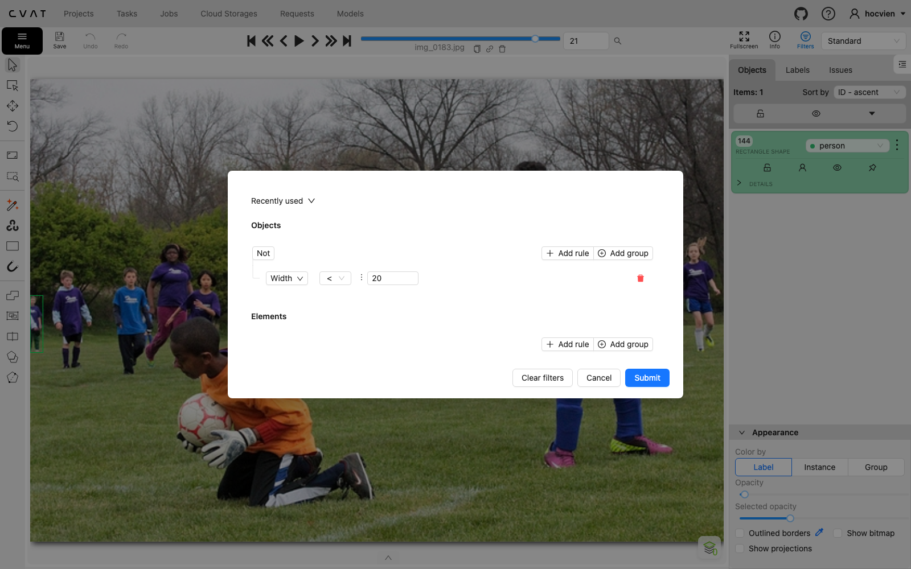

# Bonus CVAT — bằng chứng thực hành

Đã chạy trên **CVAT Community v2.83.0**, Docker local tại **http://localhost:8080**. Project **4**, task **39**, job **38**: [mở job trên máy đã dựng](http://localhost:8080/tasks/39/jobs/38). Người chấm không cần truy cập máy local: ảnh chụp và các bảng kiểm dưới đây đã được lưu trong repo.

Dữ liệu lấy từ đúng bản `clean_v1` đã train, manifest SHA1 `c74f0bf060cd0f329ab7fd972492b70b4bbe6db3`. Chọn 20 ảnh đầu hàng đợi và 5 ảnh có BOX_TINY, khử trùng rồi xếp theo tên: **25 ảnh / 164 box**. Nhãn dự án `car, person, truck, bus` có thuộc tính `can_review`.

## Bộ lọc và kết quả

Đã thiết lập bằng giao diện: **Filters → Add rule → Width → < → 20 → Submit**. Phép kiểm từ API trên cả task xác nhận **24 box / 9 ảnh**; giao diện được kiểm trực tiếp trên 5 ảnh dưới đây.



| Ảnh | Frame (từ 0) | Items sau filter | BOX_TINY trong pipeline | Dòng nhãn BOX_TINY | Screenshot |
|---|---:|---:|---:|---|---|
| img_0026 | 2 | 6 | 1 | 6 | [Xem](screenshots/img_0026.png) |
| img_0051 | 6 | 3 | 1 | 5 | [Xem](screenshots/img_0051.png) |
| img_0069 | 8 | 2 | 1 | 2 | [Xem](screenshots/img_0069.png) |
| img_0161 | 19 | 3 | 3 | 2, 3, 4 | [Xem](screenshots/img_0161.png) |
| img_0183 | 21 | 1 | 1 | 11 | [Xem](screenshots/img_0183.png) |

Trên 5 ảnh minh họa: **15 box** có width <20, trong đó **7 box** thuộc BOX_TINY. CVAT lọc theo chiều rộng <20px; pipeline kiểm cạnh ngắn <12px, nên hai kết quả không giống nhau và box nhỏ chưa chắc là lỗi.

`can_review=true` được đặt cho 24 box khớp filter để đánh dấu cần người xem lại, tương tự cờ/hàng đợi duyệt của pipeline; không có nghĩa đã xử lý lỗi. [Ảnh thuộc tính đang được chọn](screenshots/can_review.png).

Đã xuất lại YOLO 1.1: đủ 164 box, cùng lớp; sai số góc box tối đa đo được **0,00512px** so với nhãn nguồn. Bản chuyển đổi không giống từng byte. YOLO 1.1 không lưu thuộc tính can_review; thuộc tính được giữ trong CVAT và snapshot JSON. Không chỉnh hình học thủ công, không xóa box, không thay bản xuất đã train và không cộng lượt xem bonus vào ngân sách 80 ảnh chính.

## Các file kiểm chứng

- [project_labels.json](project_labels.json): nhãn dự án và thuộc tính.
- [images.zip](images.zip), [annotations_yolo11.zip](annotations_yolo11.zip): bộ nhập ảnh và nhãn.
- [preparation.json](preparation.json), [expected_frames.csv](expected_frames.csv), [expected_matches.csv](expected_matches.csv): số dự kiến tính từ nhãn nguồn.
- [session.json](session.json), [verified_counts.csv](verified_counts.csv): phiên CVAT và số box kiểm chứng sau nhập.
- [annotations_snapshot.json](annotations_snapshot.json): snapshot nhãn CVAT và các cờ can_review.
- [ui_verification.json](ui_verification.json): số Items đã đọc từ giao diện trên 5 frame.
- [exported_yolo11.zip](exported_yolo11.zip), [export_verification.json](export_verification.json): bản CVAT xuất và phép đo sai số chuyển đổi.
- [project.png](screenshots/project.png): project và cấu hình nhãn trong CVAT.

## Mở lại CVAT local trên máy này

Khởi động Docker Desktop, rồi:

```bash
cd /Users/phambaovy/Applications/vscode/vf/day09/cvat-local
docker compose -f docker-compose.yml -f docker-compose.local.yml up -d --quiet-pull
```

Mở **http://localhost:8080/tasks/39/jobs/38**, đăng nhập tài khoản **hocvien** bằng thông tin bạn đã cung cấp. Cổng web được bind vào 127.0.0.1. Docker giữ project/task trong volume để mở lại sau.

## Tái lập từ repo bài lab

```bash
python scripts/prepare_cvat_bonus.py
python scripts/create_cvat_bonus_task.py
```

Script thứ hai hỏi username/mật khẩu trong Terminal và chỉ gửi tới CVAT local; không cần ghi thông tin xác thực vào repo. Sau khi nhập, mở job được in ra, thiết lập Width <20 trên giao diện, chuyển từng frame trong bảng và chụp bằng chứng thật.

Có thể kiểm lại ZIP xuất hiện có mà không cần đăng nhập:

```bash
python scripts/verify_cvat_roundtrip.py
```

Mẫu override Docker cho máy Apple Silicon: [docker-compose.local.example.yml](../../cvat/docker-compose.local.example.yml), dùng cùng `docker-compose.yml` của [CVAT v2.83.0](https://github.com/cvat-ai/cvat/releases/tag/v2.83.0). Tài liệu chính thức: [YOLO 1.1](https://docs.cvat.ai/docs/dataset_management/formats/format-yolo/), [Filters](https://docs.cvat.ai/docs/annotation/manual-annotation/utilities/filter/).
